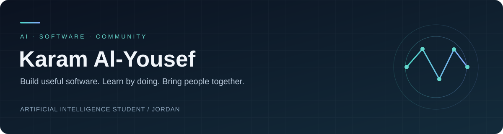

  

  
  
  

## About me

I'm **Karam Al-Yousef**, a third-year **Artificial Intelligence student at Zarqa University, Jordan**. I enjoy turning ideas into practical software, solving programming problems, and bringing students together to learn and build.

My work connects three interests: **applied AI, software development, and robotics**. Alongside my studies, I help organize technical communities, workshops, and hackathons.

- **Replit Ambassador in Jordan** — introducing students to building applications with AI tools.
- **Local Lead, NASA Space Apps Challenge — Irbid** — coordinating local community outreach and event partnerships.
- **AI & Robotics Team Leader at Breakers** — organizing student activities and collaborative projects.
- **42 Irbid** — completed two piscine levels, with hands-on programming and peer learning.

## Technical toolkit

| Area | Experience & focus |
| :--- | :--- |
| **Programming** | Python, C, C++, Java — coursework, problem solving, and projects |
| **Applied AI & data** | Regression experiments, data preparation, model evaluation, and Kaggle notebooks |
| **AI applications** | Prototyping with Replit and integrating Gemini into application workflows |
| **Web development** | Building and iterating on web applications; working with JavaScript/TypeScript projects |
| **Robotics** | Line-follower projects and preparation for robotics competitions |
| **Tools** | GitHub, Google Colab, Kaggle, PyCharm, Replit |
| **Community** | Workshop delivery, team coordination, event organization, and partnership outreach |

I'm continuing to develop my foundations in machine learning, software engineering, and robotics control.

## Selected repositories

A selection of application projects and programming exercises available on this account.

| Repository | What you'll find |
| :--- | :--- |
| [**Space Apps Jordan 2026**](https://github.com/KaramAlN/space-apps-jordan-2026) | Event registration website with a Node.js/Express backend, SQLite storage, and an admin dashboard. |
| [**Personal Portfolio**](https://github.com/KaramAlN/personl-web) | A personal website project with React, TypeScript, and a space-inspired interface. |
| [**Skyscraper Puzzle**](https://github.com/KaramAlN/sky-scraper/tree/main/ex00) | A C puzzle-solving exercise with constraint checks and a Makefile. |
| [**Stack Implementation**](https://github.com/KaramAlN/Stack-implementation) | A Java learning exercise implementing an array-based stack. |

## Beyond the repositories

Some of my work is in prototypes, notebooks, or private client projects.

- **Dental Clinic Management System** — built and delivered a clinic management application that is being used by a doctor.
- **Malhooq** — developing an AI career guidance prototype for students, exploring personalized learning roadmaps and interview practice.
- **AI Modeling Hackathon** — participated in an energy degradation regression challenge on Kaggle, working on preprocessing, ensembles, and RMSLE evaluation.
- **Student workshops** — delivered a Vibe Coding workshop at Zarqa University for **40+ attendees**.

## What I'm exploring

- Personalized English learning and AI-assisted placement practice.
- More realistic interview practice and feedback for Malhooq.
- Practical robotics design, testing, and competition preparation.

## Let's connect

I'm interested in **student opportunities, applied AI projects, robotics, and technical community collaborations**.

[LinkedIn](https://www.linkedin.com/in/karamalyousef) · [Email](mailto:karamne99@gmail.com)

Outside technology: chess, problem solving, and meeting people who enjoy building things.
